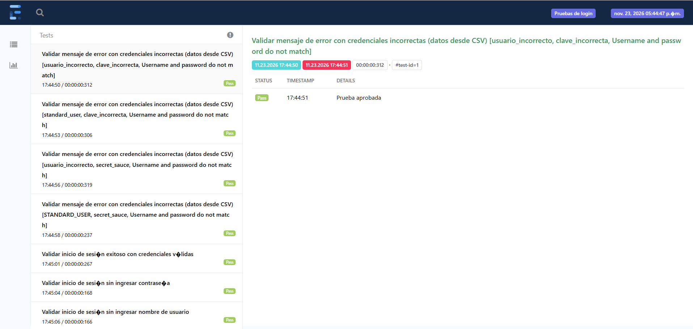

# SauceDemoQA

Proyecto de automatización de pruebas web utilizando Java, Selenium WebDriver y TestNG,
aplicando el patrón Page Object Model (POM) y pruebas basadas en datos externos (CSV).

## Tecnologías utilizadas

- Java 17
- Maven
- Selenium WebDriver 4.38.0
- TestNG 7.9.0
- IntelliJ IDEA

## Estructura del proyecto

- `BaseTest`: abre y cierra el navegador en cada prueba.
- `pages/LoginPage`: representa la página de login (Page Object Model).
- `LoginTest`: pruebas de inicio de sesión.
- `src/test/resources/credenciales.csv`: datos de prueba para credenciales incorrectas.

## Casos automatizados

| Código | Caso de prueba | Resultado |
|---|---|---|
| TC001 | Inicio de sesión exitoso | PASS |
| TC002 | Inicio de sesión con usuario bloqueado | PASS |
| TC003 | Inicio de sesión sin nombre de usuario | PASS |
| TC004 | Inicio de sesión sin contraseña | PASS |
| TC005 - TC008 | Credenciales incorrectas (4 combinaciones leídas desde CSV) | PASS |

## Reporte de pruebas

Al ejecutar `mvn test` se genera un reporte HTML con Extent Reports en
`target/reportes/reporte.html`. Cuando una prueba falla, el reporte incluye
el detalle del error y una captura de pantalla del momento del fallo.



## Cómo ejecutar las pruebas

```
mvn test
```

Los reportes se generan en `target/surefire-reports`.

## Aplicación bajo prueba

https://www.saucedemo.com/